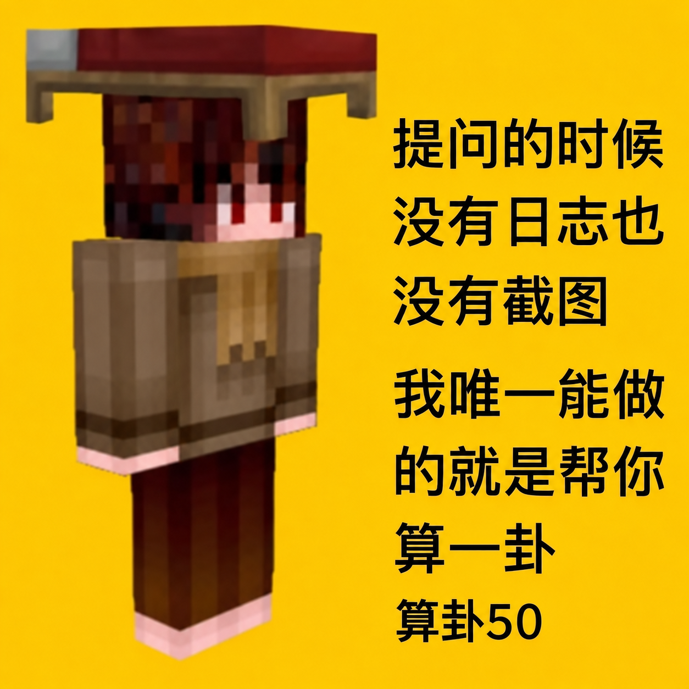

# Just Enough Items: Terraria Edition

**简体中文（原文）** · [English (machine translation)](./README.en.md)

面向《泰拉瑞亚》tModLoader 的游戏内物品与配方查询模组，灵感来自 Minecraft 的 Just Enough Items。模组会根据当前启用的模组自动建立索引，支持查询物品的所需材料、制作站与获取途径，也支持按材料反查可用配方。

[Steam 创意工坊](https://steamcommunity.com/sharedfiles/filedetails/?id=3845723114)

## 查询功能

| 查询内容 | 显示信息 |
| --- | --- |
| 合成与缺料 | 所需材料数量、可替代材料、制作站、环境条件，以及当前缺少的材料 |
| 掉落与购买 | 敌怪掉落物、基础掉率与触发条件，以及 NPC 商品的基础价格与出售条件。商人已在当前世界出现时，可在地图上定位。 |
| 宝藏袋与钓鱼匣 | 容器可开出的物品、钓鱼匣的捕获条件，以及根据渔力和钓点估算的出匣概率 |
| 微光转化与分解 | 可转换的物品、可拆回的材料，以及月相、世界进度等相关条件 |
| 生物与 Boss 召唤 | 图鉴登记的出现环境、已识别的 Boss 召唤物，支持从召唤物反查对应 Boss |
| 药草采收 | 已收录植物的采收条件。例如，死亡草在血月或满月夜晚开花，此时采收可获得种子。 |

## 搜索与收藏

- **中文与拼音**　中文界面支持输入名称、全拼或首字母缩写。按 `↑`、`↓` 可调回历史搜索词。
- **组合筛选**　使用 `@` 按来源模组筛选，使用 `#` 按物品类别或配方组筛选。支持使用 `-` 排除词条，使用 `|` 搜索多个备选词。
- **收藏与排序**　物品、NPC 和具体配方均可加入书签并拖动排序。同一物品存在多种配方时，可直接收藏指定的配方卡。

## 背包制作与模组联动

- **原版背包**　在配方页点击 `＋` 可定位至原版制作栏中的可用配方。个人设置中的「原生背包多级合成」默认关闭。开启后，保持鼠标空手，按住 `Ctrl` 并用左键点击 `＋`，即可在材料、制作站与配方条件满足时，依次制作中间材料和目标物品。
- **AE 终端**　搭配已接入 JEI 的 AE 终端时，可在终端内共用同一套搜索，并直接从配方页向终端下单。

## 转载与素材许可

欢迎在攻略、视频和模组推荐中介绍本模组，并附上[官方 Steam 创意工坊页面](https://steamcommunity.com/sharedfiles/filedetails/?id=3845723114)。如需将完整模组上传至其他平台、重新打包分发或发布修改版，请先联系作者确认授权。

本项目为面向《泰拉瑞亚》的非官方适配。界面图像、指南图标及模组图标使用了 mezz 与 Just Enough Items 贡献者的作品，采用 MIT 许可。[原版 Just Enough Items](https://github.com/mezz/JustEnoughItems)

随包中文字形源自 Noto Sans SC，采用 SIL Open Font License 1.1。拼音检索使用的 Unicode Unihan 读音数据采用 Unicode License V3。各项第三方素材按各自许可使用，完整版权和许可声明见模组包内的 `Licenses` 目录。

## 问题反馈

